# Secure Record Storage

An Express API for user accounts and private notes.

## Description

Passwords are hashed with bcrypt before they are saved. Register and login return a JSON Web Token that expires in two hours. Each note is stored with the user id from that token, and a logged-in user can list, update, and delete only their own notes.

There is no HTML page for these routes. The screenshots are the JSON the API returned while the server was running. A URL that does not match a route returns one HTML heading and no stylesheet.

Send JSON with `Content-Type: application/json`.

### `POST /api/users/register`

```json
{
  "username": "maya_records",
  "email": "maya.records@example.com",
  "password": "coffee123"
}
```

| Field | Rule |
| --- | --- |
| `username` | Required, unique, trimmed |
| `email` | Required, unique, and must match an email shape. The schema message is `Must use a valid email address` |
| `password` | Required, at least 5 characters. The database stores a bcrypt hash with 10 salt rounds |
| `role` | `user` or `admin`. The default is `user`. The route saves the request body, so a client can send `role` |

A success returns `201` with `token` and `user`. The user object includes the hash. Leaving `role` out saves `user`.

Registering `maya_records` again returned `400`. The message is a Mongo duplicate-key error:

```text
E11000 duplicate key error collection: Product_DB.users index: username_1 dup key: { username: "maya_records" }
```

A password shorter than 5 characters returned `400`. For the password `tiny`, the message was:

```text
User validation failed: password: Path `password` (`tiny`, length 4) is shorter than the minimum allowed length (5).
```

The validation error repeats the password that was submitted.

### `POST /api/users/login`

```json
{
  "email": "maya.records@example.com",
  "password": "coffee123"
}
```

Returns `200` with `token` and `user`. On login, `_id` is the first field in `user`. An unknown email returns `400` and `Can't find this user`. A wrong password returns `400` and `Wrong password!`.

The token payload is `username`, `email`, and `_id`. It does not include `role`. It expires in 2 hours.

Every note route runs `authMiddleware` first. These requests sent `Authorization: Bearer <token>`. The middleware also accepts a token on `req.body.token` or `req.query.token`. A missing token returns `401` and `You must be logged in to do that.` A token that does not verify returns `401` and `Invalid token.`

### `POST /api/notes`

```json
{
  "title": "Lab note",
  "content": "This note belongs to the logged-in user."
}
```

`title` and `content` are required. A body with only a title returned `400`:

```text
Note validation failed: content: Path `content` is required.
```

A success returns `201`. `user` is `req.user._id` from the token. The route sets `user` from the token, so the request body does not include an owner id.

### `GET /api/notes`

Returns the notes owned by the logged-in user. It does not return every note in the database. `leo_records` was signed in while Maya's note was still stored. His list was empty.

### `PUT /api/notes/:id`

The route loads the note, then compares `note.user` with the id in the token. A mismatch returns `403` and `User is not authorized to update this note.` A missing note returns `404` and `No note found with this id!` An id that is not an ObjectId, such as `not-an-id`, returns `500` and `Cast to ObjectId failed for value "not-an-id"`.

The owner update removes `user` from the body before saving, so the request cannot change the owner. A success returns `200` and the updated note. Maya changed the title and content. The body also sent a different `user` value. The saved owner stayed Maya's id.

### `DELETE /api/notes/:id`

The same ownership check runs first. A mismatch returns `403` and `User is not authorized to delete this note.` A missing note returns the same `404` message as update. A success returns `200` and `{ "message": "Note deleted!" }`.

| Code | Meaning in this API |
| --- | --- |
| `200` | Login, list, update, or delete succeeded |
| `201` | A user or note was created |
| `400` | Register or login failed, or the note body is invalid |
| `401` | The token is missing or does not verify |
| `403` | The token is valid, and this user does not own the note |
| `404` | The URL does not match a route, or the note id is not stored |
| `500` | The note id could not be cast to an ObjectId, or the database call threw |

`GET /api/register` does not match a route. `GET /api/notes/:id` does the same, because there is no route that loads one note.

## Screenshots

### Accounts

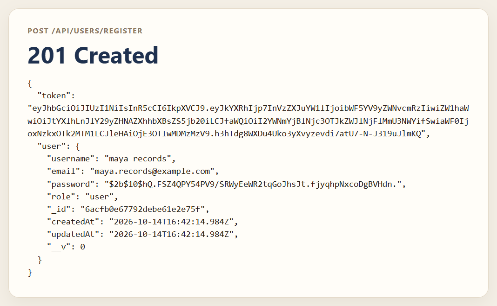

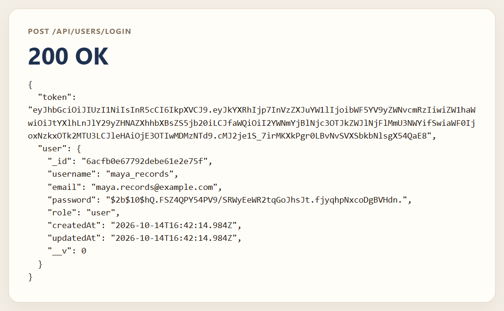

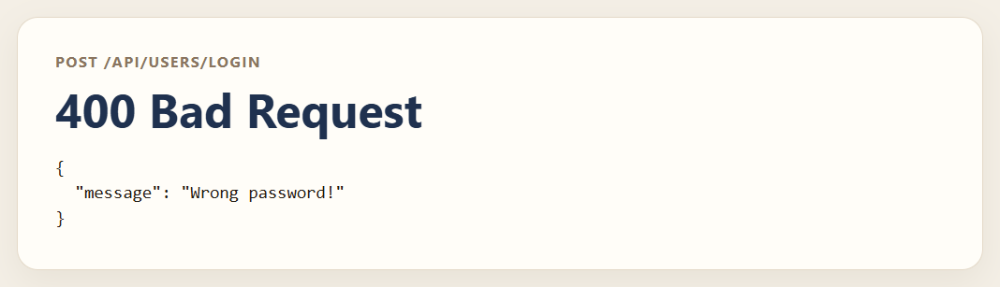

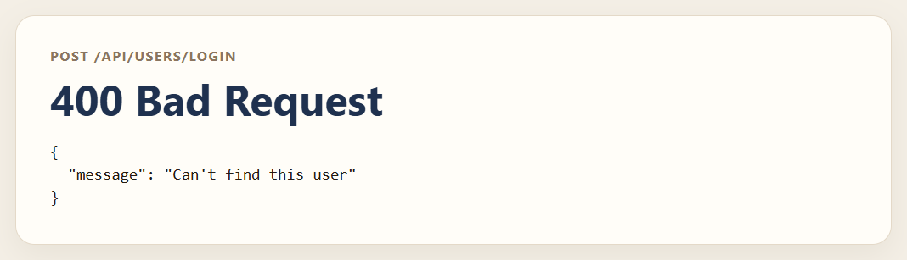

### Notes

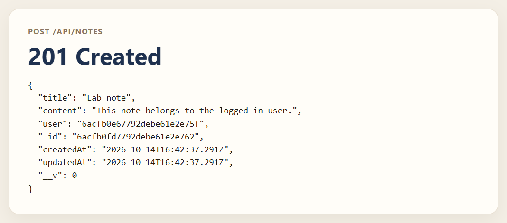

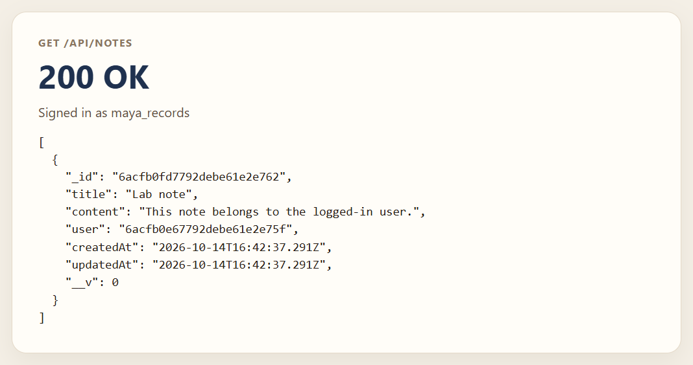

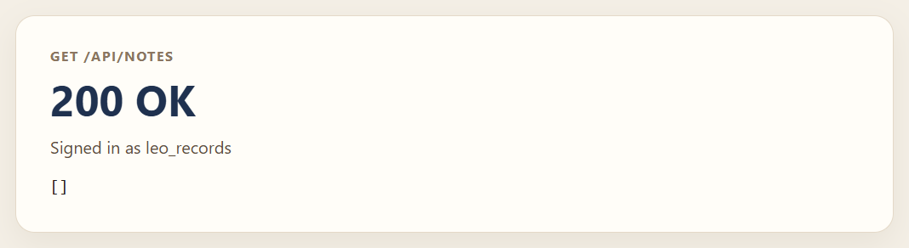

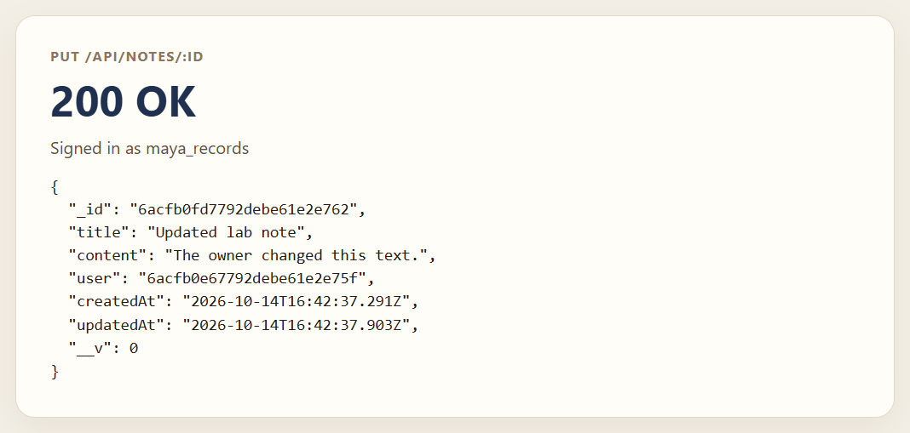

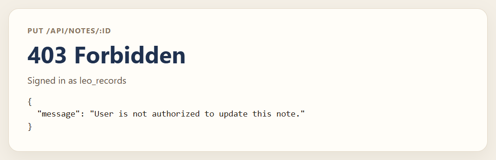

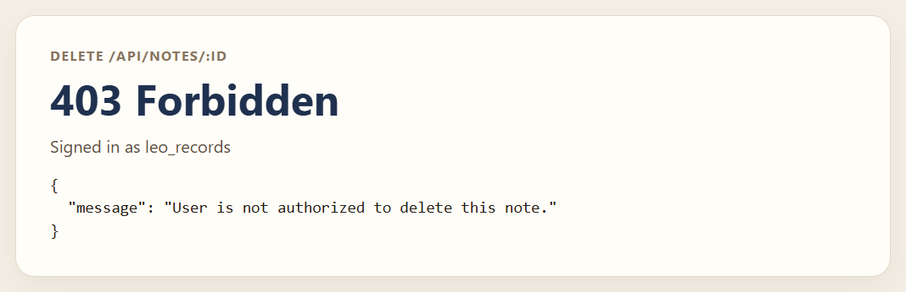

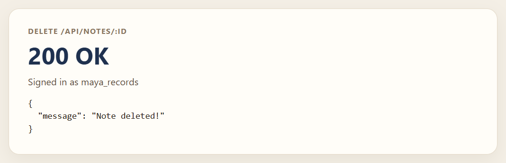

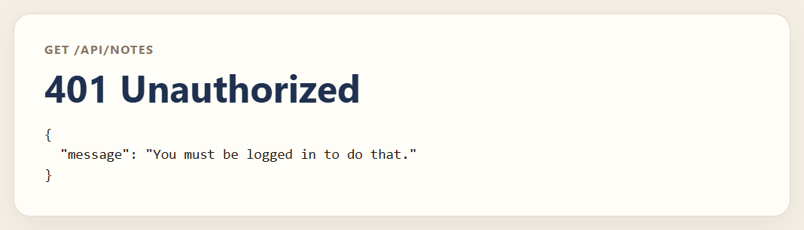

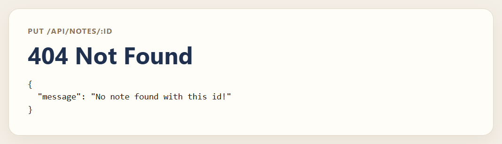

### Unknown URL


## Getting Started

### Dependencies

* Node.js and npm
* MongoDB

| Variable | Purpose |
| --- | --- |
| `MONGO_URI` | MongoDB connection string |
| `JWT_SECRET` | Secret used to sign tokens |
| `PORT` | Port for Express |

`.env` is listed in `.gitignore`.

### Installing

```bash
npm install
```

### Executing program

```bash
npm start
```

When the database connects, the terminal prints `🌍 Now listening on localhost:3000`. Use that port in every URL. `server.js` reads `PORT` from the environment and uses `3001` when `PORT` is not set. `npm run dev` runs the same file with nodemon.

## Help

A short password error repeats the submitted password. Register and login responses include the bcrypt hash. A missing token returns `401` and `You must be logged in to do that.` A token that does not verify returns `Invalid token.` `not-an-id` returns `500`. There is no route that loads one note, so `GET /api/notes/:id` is the HTML 404.

## Authors

[Mamadou Moussa Balde](https://www.linkedin.com/in/2mb/)

## Version History

* Current local run
    * Listened at http://localhost:3000
    * Accounts `maya_records` and `leo_records` were used
    * Maya's note was created, updated, and deleted

## License

This folder does not include a `LICENSE.md` file.

## Acknowledgments

* [README template](https://gist.github.com/DomPizzie/7a5ff55ffa9081f2de27c315f5018afc)
